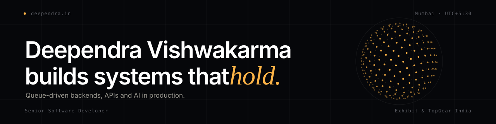

**Senior Software Developer** at Exhibit & TopGear India, Mumbai.

I build backends that stay up on launch day: PHP/Laravel, queue-driven architecture, PostgreSQL and Redis, with LLM, RAG and MCP integration in production. Building for clients since 2018.

[deependra.in](https://deependra.in) · [Writing](https://deependra.in/writing) · [LinkedIn](https://www.linkedin.com/in/deependra-vishwakarma/)

## Selected work

| System | Outcome | Built with |
| :-- | :-- | :-- |
| InfluencerX voting platform | Served 1.6M+ users over a 22-day campaign. 2,000+ concurrent users at peak, 99.99% availability. | Laravel, Redis, queues, NGINX, CDN, GCP |
| TopGear India CMS | Main-page load cut from 1–3 minutes to 3 seconds. Engagement up 63%, bounce rate down from 70% to 30%. | Laravel, Redis |
| Exhibit Social | Indexed 10,000+ influencers and ran 30+ large brand campaigns. | Laravel, PostgreSQL, Flutter clients |
| Immunomate | Telemedicine app with 500+ registered users. Redis caching cut API response time by 40%. | Laravel, Firebase Firestore |

Client and employer code is private. The write-ups, and the definition behind every number, are on [deependra.in/work](https://deependra.in/work).

## Open source

| Project | What it does |
| :-- | :-- |
| [tokenly](https://github.com/deependra04/tokenly) | Tracks every AI API cost in one line, `tokenly.init()`. Logs tokens, cost, latency and cache hits to a local SQLite file. No proxy, no account. Python, MIT. |
| [mcp-builder](https://github.com/deependra04/mcp-builder) | Laravel package that generates Model Context Protocol servers and tools from YAML/JSON configs, Eloquent models and routes. PHP, MIT. |
| [Uniblox](https://github.com/deependra04/Uniblox) | Full-stack insurance e-commerce monorepo: Express + TypeScript API, React 19 frontend, 11 documented architectural decisions. |

## Stack

| | |
| :-- | :-- |
| Backend | PHP 8, Laravel, FastAPI, Python, TypeScript |
| Frontend | Vue.js, React, Inertia.js, Blade, Tailwind CSS |
| Data | MySQL, PostgreSQL with pgvector, Redis, Elasticsearch, Firestore |
| Infrastructure | AWS, GCP, Docker, NGINX, CI/CD, Ubuntu |
| AI | LLM integration, RAG pipelines, MCP servers, ML model deployment |
| Practice | REST API design, queue-driven architecture, RBAC, OAuth 2.0, JWT, security hardening |
